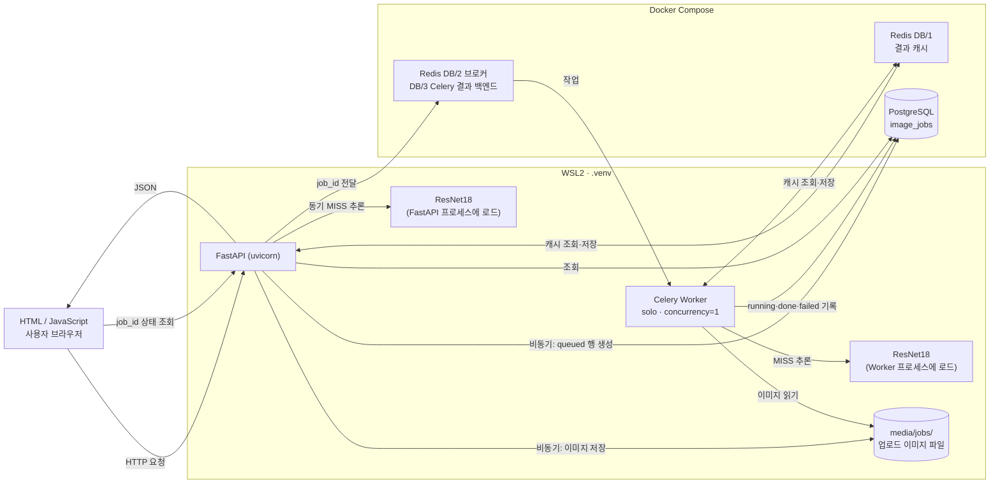

# 시스템 아키텍처

## 1. 구성도

## 2. 컴포넌트 역할

| 컴포넌트 | 실행 위치 | 사용 파일 / 서비스 | 역할 |
|---|---|---|---|
| 브라우저 | Windows | `templates/sync.html`, `templates/async.html` | 이미지 업로드, 결과 표시, 비동기 상태 폴링 |
| FastAPI | WSL2 `.venv` (터미널 B) | `main.py`, `ai/router_sync.py`, `ai/router_async.py`, `ai/router_web.py` | 요청 검증, 동기 분류, 작업 접수·상태 조회 |
| ResNet18 | FastAPI·Worker 각 프로세스 | `ai/hf_model.py`, `ai/services.py`, `artifacts/beans_resnet18/` | 콩잎 3클래스 분류 |
| Redis 캐시 | Docker, DB/1 | `ai/cache_service.py` | 같은 이미지의 결과 재사용 (TTL 600초) |
| Redis 브로커 | Docker, DB/2 | `ai/celery_app.py` | Celery 작업 전달 |
| Celery 결과 백엔드 | Docker, DB/3 | `ai/celery_app.py` | Celery 작업 결과 저장소 설정 |
| PostgreSQL | Docker | `ai/models.py`, `image_jobs` | 비동기 작업 상태·결과 기록 |
| Celery Worker | WSL2 `.venv` (터미널 A) | `ai/tasks.py` | 비동기 추론, DB 갱신 |
| 업로드 이미지 | WSL2 파일시스템 | `media/jobs/<uuid>.bin` | FastAPI가 저장하고 Worker가 읽음 |

## 3. 실행 환경

| 항목 | 값 | 근거 |
|---|---|---|
| 운영체제 | Windows + WSL2 Ubuntu (kernel 6.18.54.1-microsoft-standard-WSL2) | Worker 시작 로그 |
| Python | 3.10, 가상환경 `.venv` | 실행 로그의 `/usr/lib/python3.10` |
| Celery | 5.6.3, pool `solo`, concurrency 1 | Worker 시작 로그 |
| 추론 장치 | CPU | Worker 로그 `Device set to use cpu` |
| Docker 서비스 | Redis `redis:7.4-alpine`, PostgreSQL `postgres:17-alpine` | `compose.yaml` |
| 접속 주소 | Redis `127.0.0.1:6379`, PostgreSQL `127.0.0.1:5432` | Worker 시작 로그, `ai/config.py` 기본값 |
| 모델 경로 | `artifacts/beans_resnet18` | `.env`의 `MODEL_PATH`, API 응답의 `model_id` |

- 프로세스 구성: 터미널 A에서 Celery Worker, 터미널 B에서 `uvicorn main:app --reload`를 실행하고, Redis와 PostgreSQL만 Docker로 실행했다.
- `compose.yaml`에는 `web`, `worker`, `trainer` 서비스도 정의되어 있으나, 이 검증에서는 `web`과 `worker` 컨테이너를 중지하고 사용하지 않았다.

## 4. 구조 검증 결과

**동기** — 브라우저 → FastAPI → Redis 캐시 조회 → (MISS) ResNet18 추론 → 결과 저장 → FastAPI → 브라우저
- `POST /api/sync/classify/`에 클래스별 이미지를 올려 HTTP 200과 `top1`, `all`, `inference_ms`, `cache_hit`를 확인했다.
- 동기 요청은 기본 코드에서 `image_jobs`에 행을 만들지 않는다.

**비동기** — 브라우저 → FastAPI → 이미지 파일 저장 → PostgreSQL(`queued`) → Redis 브로커 → Worker → 캐시 조회 → (MISS) 추론 → PostgreSQL(`done`) → 브라우저가 `job_id`로 조회
- MISS: job 6 (`cache_hit: false`, `inference_ms: 23.53`)
- HIT: job 7 (`cache_hit: true`, `inference_ms: null`, 같은 이미지·같은 점수)
- Worker 로그에서 job별 `received` → `succeeded` 줄을 확인했다. (증빙: `evidence/celery_log.png`)

## 5. 유의사항

- **Redis 캐시와 브로커는 역할이 다르다.** 캐시(DB/1)는 같은 이미지의 결과를 재사용하고, 브로커(DB/2)는 FastAPI가 만든 작업을 Worker에 전달한다.
- **FastAPI와 Worker는 별도 프로세스이므로 모델이 각각 로드될 수 있다.** 관찰값: Worker가 모델을 처음 쓰는 작업은 `inference_ms`가 약 2초(job 2: 1,940.09 / job 8: 2,210.35)였고, 모델이 올라간 뒤의 MISS는 20ms대(job 3: 24.97 / job 6: 23.53)였다.
- `inference_ms: null`은 캐시 HIT에서 모델 추론을 생략했다는 뜻이며, 추론시간이 0ms라는 뜻이 아니다.
- 이 구조도는 코드와 실행 로그로 확인한 범위를 나타낸다. Redis·PostgreSQL 컨테이너 내부 동작은 검증하지 않았다.

## 증빙

- `evidence/celery_log.png` — Worker의 작업 수신·완료 로그
- `evidence/db_rows.png` — `image_jobs` 조회 결과
