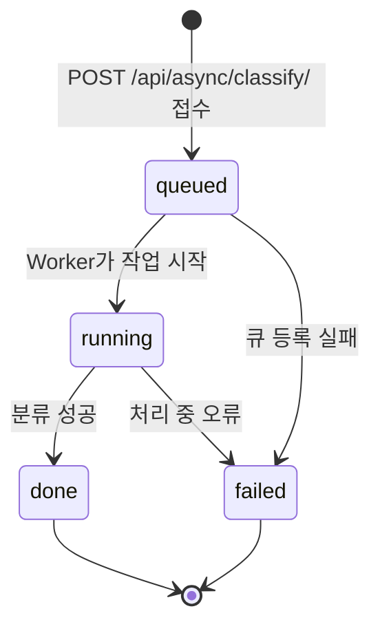

# DB 구조 및 작업 이력

## 1. DB 개요

| 항목 | 내용 |
|---|---|
| DBMS | PostgreSQL 17 (Docker `postgres:17-alpine`) |
| 접속 | `127.0.0.1:5432` / DB `vision_db` / 사용자 `vision_user` |
| 사용 테이블 | `image_jobs` |
| 저장 대상 | 비동기 분류 작업의 상태와 결과 |
| 저장하지 않는 것 | 동기 API(`/api/sync/classify/`) 요청은 기본 코드에서 `image_jobs`에 행을 만들지 않는다. |

## 2. 테이블 구조

`\d image_jobs` 실제 조회 결과를 정리했다. (증빙: `evidence/db_schema.png`)

| 컬럼 | 타입 | NULL 허용 | 설명 |
|---|---|---|---|
| id | integer (시퀀스 자동 증가) | 불가 | 작업 번호, API의 `job_id` |
| image_path | varchar(150) | 불가 | 업로드 이미지가 저장된 파일 위치 (`media/jobs/` 아래 `.bin` 파일) |
| status | varchar(20) | 불가 | 작업 상태 |
| model_id | varchar(255) | 불가 | 사용한 모델 경로 |
| top1_label | varchar(200) | 허용 | 1위 예측 라벨 |
| top1_score | double precision | 허용 | 1위 점수 |
| all_scores | json | 허용 | 전체 클래스 점수 (API 응답에서는 `all` 필드) |
| inference_ms | double precision | 허용 | 모델 추론 시간(ms), 캐시 HIT이면 비어 있음 |
| cache_hit | boolean | 허용 | Redis 캐시 사용 여부 |
| error_message | text | 허용 | 실패 시 오류 메시지 |
| created_at | timestamptz | 불가 | 작업 접수 시각 |
| updated_at | timestamptz | 불가 | 마지막 갱신 시각 |

인덱스: `image_jobs_pkey` (기본키 `id`), `ix_image_jobs_status` (`status` 조회용)

## 3. 상태 전이



- `queued` 행은 FastAPI가 접수 직후에 만들고, `running`, `done`, `failed`는 Worker(`ai/tasks.py`)가 기록한다.
- 이미 `done`인 작업은 Worker가 다시 처리하지 않고 반환한다.
- 큐 등록(`delay`)에 실패하면 FastAPI가 해당 행을 `failed`로 기록하고 503을 반환한다.

## 4. 작업 이력 (실제 조회 결과)

조회 명령:

```bash
docker compose exec postgres psql -U vision_user -d vision_db -c \
  'SELECT id, status, model_id, top1_label, cache_hit, inference_ms, error_message FROM image_jobs WHERE id <= 8 ORDER BY id DESC;'
```

| id | status | top1_label | cache_hit | inference_ms | error_message |
|---:|---|---|---|---:|---|
| 8 | done | bean_rust | f | 2210.35 | |
| 7 | done | angular_leaf_spot | t | | |
| 6 | done | angular_leaf_spot | f | 23.53 | |
| 5 | done | angular_leaf_spot | t | | |
| 4 | done | angular_leaf_spot | t | | |
| 3 | done | angular_leaf_spot | f | 24.97 | |
| 2 | done | angular_leaf_spot | f | 1940.09 | |
| 1 | done | healthy | f | 2226.19 | |

이후 측정과 시험으로 작업이 추가되었으므로 위 표는 초기 검증 시점(id 1~8)만 조회한 것이다.

모든 행의 `model_id`는 `artifacts/beans_resnet18`이다. (증빙: `evidence/db_rows.png`)

## 5. 이력 해석

- **상태:** 8개 작업이 모두 `done`이고, `failed` 행은 없다.
- **캐시 MISS/HIT:** `cache_hit`이 `f`인 행(1, 2, 3, 6, 8)은 모델 추론 시간이 기록되어 있고, `t`인 행(4, 5, 7)은 `inference_ms`가 비어 있다. HIT은 모델 추론을 생략했다는 뜻이며 추론시간이 0ms라는 뜻이 아니다.
- **job 6과 7:** 같은 이미지를 연속으로 올린 MISS/HIT 쌍이다. 두 행의 `top1_label`이 같고, 응답 JSON의 점수도 같다.
- **job 8:** Worker를 중지한 상태에서 접수했고, 조회 시 `queued`로 유지되다가 Worker를 다시 실행한 뒤 `done`이 되었다.
- **추론시간:** job 1, 2, 8의 약 2초는 모델 로딩이 포함된 값으로 보이고, 이후 MISS(job 3, 6)는 20ms대였다. 이 값은 성능 측정(산출물 6)에서 워밍업으로 구분한다.
- **오류:** `error_message`는 모든 행이 빈칸이다. 실제 환경에서 `failed` 작업은 발생하지 않았으므로 실패 행의 예시는 없다. (`failed`가 기록되는 경로는 모의 테스트 `tests/test_api.py`에서만 확인한다.)

## 6. 이번 조회의 범위

- 위 SELECT는 `image_path`, `top1_score`, `all_scores`, `created_at`, `updated_at` 컬럼을 포함하지 않았다.
- 작업 이력은 조회 시점에 보인 최근 10건 이내의 8행이다.

## 증빙

- `evidence/db_schema.png` — `\d image_jobs` 결과
- `evidence/db_rows.png` — `image_jobs` 조회 결과
