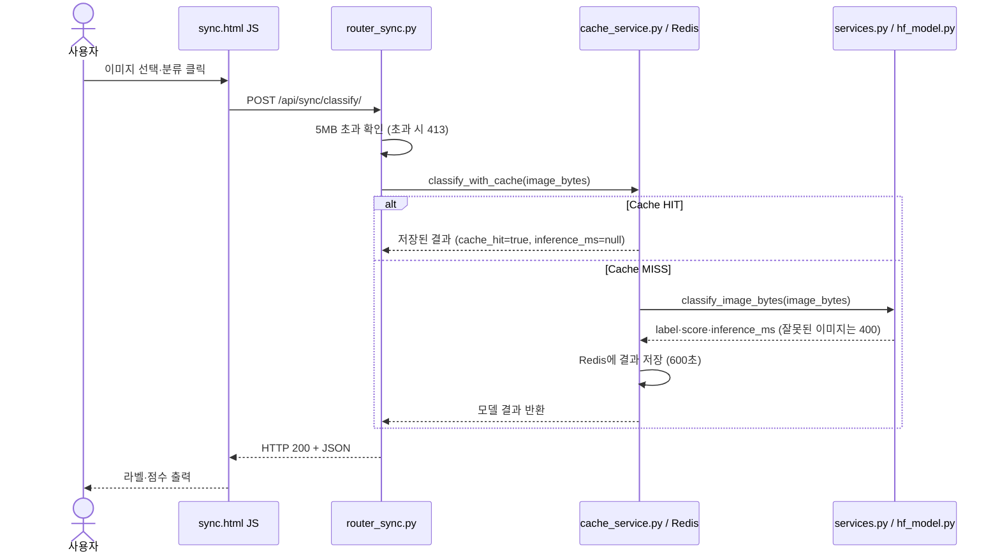
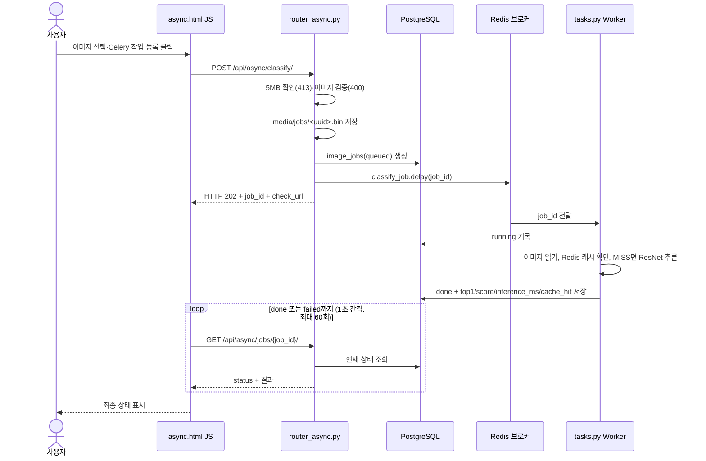

# AI 분석 버튼 처리 흐름

## A. 동기 버튼 클릭 시퀀스

## B. 비동기 버튼 클릭 시퀀스

- 큐 등록(`delay`)이 실패하면 FastAPI가 해당 행을 `failed`로 기록하고 503을 반환한다.
- Worker 처리 중 예외가 발생하면 `failed`와 `error_message`를 기록한 뒤 예외를 다시 던진다.
- 화면의 `상태조회 중지` 버튼은 폴링만 멈추며 Worker 작업은 계속된다.

## 실제 코드 연결표

| 단계 | 시작 파일 | 핵심 함수·처리 | 반환 / 다음 단계 |
|---|---|---|---|
| 동기 1 | `templates/sync.html` | `fetch()` | `POST /api/sync/classify/` |
| 동기 2 | `ai/router_sync.py` | `classify_sync()` | 크기 확인 후 `classify_with_cache()` |
| 동기 3 | `ai/cache_service.py` | `classify_with_cache()` | Cache HIT 반환 또는 `classify_image_bytes()` 호출 후 결과 저장 |
| 동기 4 | `ai/services.py` | `classify_image_bytes()`, `load_rgb_image()` | `top1`, `all`, `inference_ms` |
| 비동기 1 | `templates/async.html` | `fetch()` + 1초 간격 폴링 | `POST /api/async/classify/`, `check_url` 조회 |
| 비동기 2 | `ai/router_async.py` | `enqueue_classify()` | 파일 저장, DB `queued`, `202/job_id` |
| 비동기 3 | `ai/tasks.py` | `classify_job()` | DB `running` → `done` / `failed` |
| 비동기 4 | `ai/router_async.py` | `get_job()` | 상태 및 예측 JSON |

## 실제 실행 근거

| 경로 | 실행한 작업 | 확인한 값 |
|---|---|---|
| 동기 | 클래스별 이미지 1장씩 업로드 | HTTP 200, `top1`, `cache_hit: false` |
| 비동기 MISS | job 6 | `done`, `cache_hit: false`, `inference_ms: 23.53` |
| 비동기 HIT | job 7 (같은 이미지) | `done`, `cache_hit: true`, `inference_ms: null` |
| 비동기 대기 | job 8 (Worker 중지 중 접수) | `queued` 유지 → Worker 재실행 후 `done` |

Worker 로그에서 job 6은 `received` 후 약 0.036초, job 7은 약 0.007초 만에 `succeeded`로 끝났다. 이 처리 시간은 파일 읽기와 DB 기록까지 포함한 작업 전체 시간이며, 모델 추론시간(`inference_ms`)과 다르다.

## 비교 결론

- **동기:** HTTP 응답을 받을 때 분류 결과가 포함된다.
- **비동기:** HTTP 202로 작업이 접수되고, 결과는 `job_id`로 별도 조회해서 받는다.
- 분류를 수행하는 ResNet18 모델은 두 경로에서 같으며, 비동기 경로는 모델을 Worker 프로세스에서 실행한다.

## 증빙

- `evidence/ui_sync.png` — 동기 화면 결과
- `evidence/ui_async.png` — 비동기 화면 (접수 → done)
- `evidence/celery_log.png` — Worker의 `received` / `succeeded` 로그
- `evidence/worker_stopped.png` — Worker 중지 중 `queued` 유지
